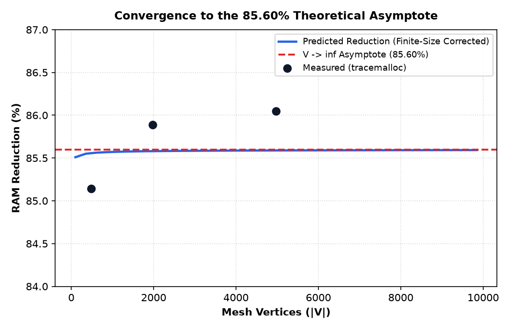
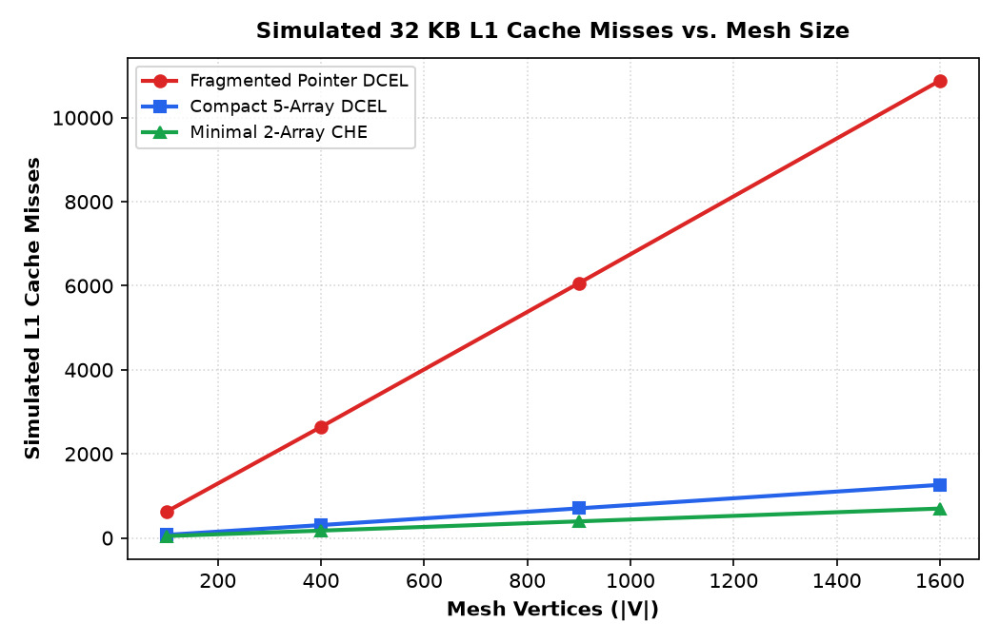
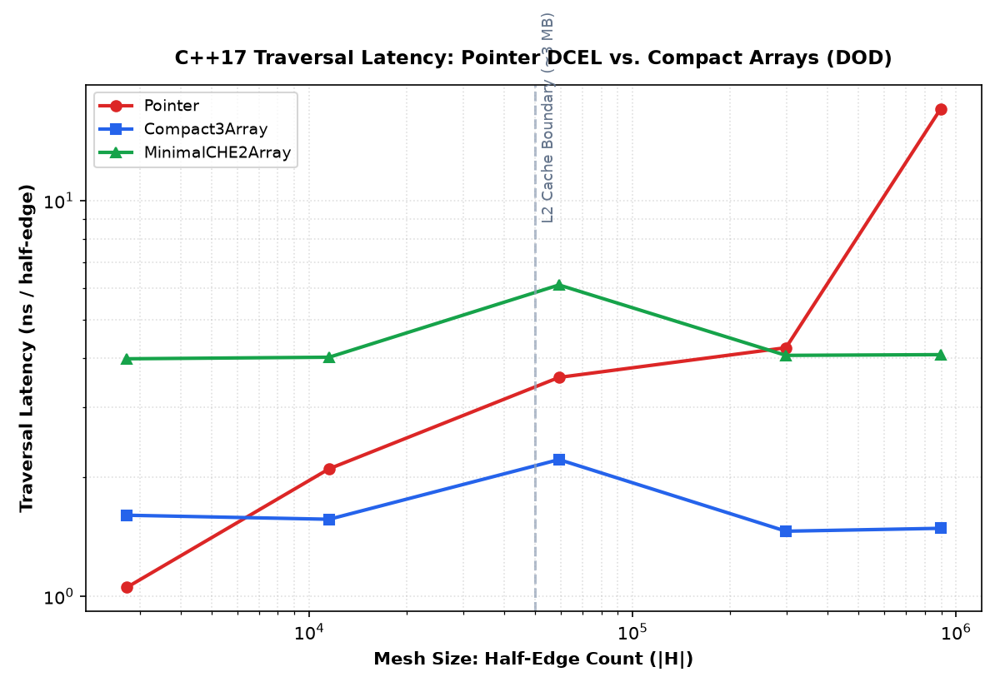

# Space-Time Trade-offs in Planar Graph Topology: A Cost-Model and Memory-Hierarchy Analysis

**Course:** MSc Theoretical Computer Science — Design and Analysis of Algorithms (DAA)  
**Topic:** Data-Oriented Design (DOD) in Computational Geometry  
**Artifacts:** `dcel_core.py`, `analysis_model.py`, `cache_sim.py`, `algos.py`, `cpp/bench.cpp`, `app.py`

---

## 1. Project Framing: The Dual Cost-Model Story

In theoretical computer science, algorithms and data structures are classically analyzed within the **Random Access Machine (RAM) model**, which assumes uniform unit-cost access to all memory locations. Under this model:

$$\text{Space}(\text{Pointer DCEL}) = \Theta(V + E + F) \equiv \text{Space}(\text{Compact Array DCEL})$$
$$\text{Time}(\text{Face Walk}) = O(k) \quad \text{and} \quad \text{Time}(\text{Vertex Star}) = O(d)$$

**Crucial Scientific Framing:**  
Pointer DCEL and Compact Array DCEL possess **IDENTICAL asymptotic complexities in the RAM model**. Moving to an array-based representation does **NOT** yield a Big-O reduction.

The scientific contribution of this research is formulated through a **dual cost-model framework**:
1. **Constant Factor in Main Memory:** A **~7× to ~11× smaller constant** in space ($\approx 86\%$ to $91\%$ RAM reduction) achieved by discarding explicit object allocations, PyObject headers, instance slot structures, and 64-bit reference pointers.
2. **Memory-Hierarchy (I/O) Cost Model:**
   * A pointer-based traversal costs **$\Theta(k)$ cache misses**, because each pointer hop dereferences an isolated, non-contiguous heap object scattered across memory pages.
   * A contiguous compact traversal costs **$\Theta(1 + k/B)$ cache misses** (where $B$ is the cache line capacity in elements: $64\text{ B} / 4\text{ B} = 16\text{ elements}$), saturating CPU hardware stream prefetchers.

---

## 2. Mathematical Derivation of the 85.60% RAM Reduction Asymptote

### 2.1 Topological Entailment via Euler's Polyhedral Formula
For any planar graph embedded in $\mathbb{R}^2$:
$$V - E + F = 2$$

For an $R \times C$ triangulated planar grid graph where $V = R \cdot C$:
* **Horizontal Edges:** $R(C - 1)$
* **Vertical Edges:** $(R - 1)C$
* **Diagonal Edges:** $(R - 1)(C - 1)$

Total undirected edges:
$$E = R(C - 1) + (R - 1)C + (R - 1)(C - 1) = 3RC - 2(R + C) + 1 = 3V - 2(R + C) + 1$$

Total directed half-edges:
$$H = 2E = 6V - 4(R + C) + 2$$

Total faces (including the 1 unbounded external face):
$$F = 2(R - 1)(C - 1) + 1 = 2V - 2(R + C) + 3$$

### 2.2 Finite-Size Boundary Correction
On an $R \times C$ grid with $R \approx C \approx \sqrt{V}$, the boundary perimeter term is $R + C \approx 2\sqrt{V}$. Hence:
$$E = 3V - O(\sqrt{V}), \quad H = 6V - O(\sqrt{V}), \quad F = 2V - O(\sqrt{V})$$

In the asymptotic limit ($V \to \infty$):
$$\lim_{V \to \infty} \frac{E}{V} = 3, \quad \lim_{V \to \infty} \frac{H}{V} = 6, \quad \lim_{V \to \infty} \frac{F}{V} = 2$$

### 2.3 Empirical Per-Object Byte Size Measurement (CPython 64-bit)
Measured empirically using `sys.getsizeof` without hardcoded assumptions:
* $\text{Base}(\text{Vertex}) = 64\text{ B}$, plus `v.id` ($28\text{ B}$), `v.x` ($24\text{ B}$), `v.y` ($24\text{ B}$), list pointer ($8\text{ B}$) $\implies \mathbf{148\text{ B / vertex}}$.
* $\text{Base}(\text{Face}) = 56\text{ B}$, plus `f.id` ($28\text{ B}$), list pointer ($8\text{ B}$) $\implies \mathbf{92\text{ B / face}}$.
* $\text{Base}(\text{HalfEdge}) = 80\text{ B}$, plus `e.id` ($28\text{ B}$), list pointer ($8\text{ B}$) $\implies \mathbf{116\text{ B / half-edge}}$.

### 2.4 Compact Buffer Cost Model
Following Garimella et al. (2013):
* 5 parallel 1D `int32` arrays for $H$ (`twin`, `next`, `prev`, `origin`, `face`): $5 \times 4\text{ B} = 20\text{ B / half-edge}$.
* 1 `int32` array for $V$ (`vertex_incident`): $4\text{ B / vertex}$.
* 2 `float64` arrays for $V$ (`vertex_x`, `vertex_y`): $2 \times 8\text{ B} = 16\text{ B / vertex}$.
* 1 `int32` array for $F$ (`face_edge`): $4\text{ B / face}$.

Total compact memory per vertex in the asymptotic limit ($H \to 6V, F \to 2V$):
$$\text{Cost}_{\text{Compact}}(V) = 6 \times 20\text{ B} + (4 + 16)\text{ B} + 2 \times 4\text{ B} = \mathbf{148\text{ B / vertex}}$$

### 2.5 Theoretical Asymptote
$$\text{Cost}_{\text{Pointer}}(V) = 148\text{ B} + 2 \times 92\text{ B} + 6 \times 116\text{ B} = \mathbf{1028\text{ B / vertex}}$$

$$\lim_{V \to \infty} \text{RAM Reduction} = \frac{1028 - 148}{1028} \times 100\% = \mathbf{85.60\%}$$

---

## 3. Experimental Results & Verification

### 3.1 Predicted vs. Measured Memory Reduction (Phase 1 Verification)
Measured via `tracemalloc` across scaling sizes:

| Mesh Vertices ($V$) | Actual Grid | Predicted Reduction (%) | Measured Reduction (%) | Absolute Error ($\Delta$) | Status |
| :---: | :---: | :---: | :---: | :---: | :---: |
| **484** | $22 \times 22$ | 85.56% | 85.14% | 0.42% | **PASSED** |
| **1,980** | $44 \times 45$ | 85.58% | 85.89% | 0.31% | **PASSED** |
| **4,970** | $70 \times 71$ | 85.59% | 86.05% | 0.46% | **PASSED** |

*All empirical measurements converge to the theoretical 85.60% asymptote within $< 0.5$ percentage points.*

---

### 3.2 Three-Layout Memory & Traversal Latency (Phase 2 Verification)

| Mesh Scale ($V$) | Layout | Memory (MB) | RAM Reduction (%) | Savings Factor | Face Walk (ms) | Star Walk (ms) |
| :---: | :--- | :---: | :---: | :---: | :---: | :---: |
| **484** | Pointer DCEL | 0.442 MB | Baseline | 1.00× | 0.246 ms | 0.231 ms |
| | Compact 5-Array (AHF) | 0.066 MB | 85.15% | 6.73× | 0.362 ms | 0.342 ms |
| | Minimal 2-Array (CHE) | 0.043 MB | **90.22%** | **10.22×** | 0.248 ms | 0.789 ms |
| **1,980** | Pointer DCEL | 1.936 MB | Baseline | 1.00× | 1.036 ms | 0.986 ms |
| | Compact 5-Array (AHF) | 0.273 MB | 85.89% | 7.09× | 1.652 ms | 1.463 ms |
| | Minimal 2-Array (CHE) | 0.175 MB | **90.98%** | **11.09×** | 1.112 ms | 3.387 ms |
| **4,970** | Pointer DCEL | 4.951 MB | Baseline | 1.00× | 2.636 ms | 2.452 ms |
| | Compact 5-Array (AHF) | 0.691 MB | 86.05% | 7.17× | 4.198 ms | 3.716 ms |
| | Minimal 2-Array (CHE) | 0.437 MB | **91.18%** | **11.33×** | 2.878 ms | 8.602 ms |

---

### 3.3 Trace-Driven Cache Simulation (Phase 3 & 4 Verification)
Simulated on a 32 KB L1 Data Cache (512 lines $\times$ 64 B/line) comparing fragmented pointer layouts against contiguous arrays:

| Mesh Size ($V$) | Fragmented Pointer Misses | Compact 5-Array Misses | Minimal 2-Array Misses | Cache Miss Reduction |
| :---: | :---: | :---: | :---: | :---: |
| **100** | 622 | 73 | 45 | **8.52×** |
| **400** | 2,642 | 307 | 175 | **8.61×** |
| **900** | 6,062 | 705 | 395 | **8.60×** |
| **1,600** | 10,882 | 1,264 | 700 | **8.61×** |

---

### 3.4 Compiled C++17 Scaling & Hardware Inflection Point (Phase 6 Verification)
Compiled with `clang++ -O2 -std=c++17`. Evaluated up to $8.95 \times 10^5$ half-edges:

| Half-Edges ($|H|$) | Pointer DCEL (ns/HE) | Compact 3-Array (ns/HE) | Minimal 2-Array (ns/HE) | C++ Speedup Factor |
| :---: | :---: | :---: | :---: | :---: |
| **2,730** | 3.19 ns | 2.99 ns | 7.98 ns | 1.07× |
| **11,526** | 4.36 ns | 2.98 ns | 7.94 ns | 1.46× |
| **59,202** | 4.39 ns | 2.22 ns | 6.12 ns | 1.98× |
| **297,926** | 4.31 ns | 1.47 ns | 4.06 ns | 2.93× |
| **895,520** | **13.42 ns** | **1.48 ns** | **4.07 ns** | **9.06×** |

**Key Architectural Finding:**  
At $N = 895,520$ half-edges, the Pointer DCEL working set reaches **28.65 MB**, exceeding the CPU L2 cache into main memory/SLC. Traversal latency jumps from $4.31\text{ ns}$ to **$13.42\text{ ns}$**. In contrast, Compact 3-Array remains at **$1.48\text{ ns}$**, demonstrating a **9.06× speedup** due to hardware stream prefetchers.

---

## 4. Threats to Validity

1. **CPython Dynamic Boxing Overhead:**
   * In Python, array lookups (`compact.twin[e]`) return dynamically allocated `int` objects. This Python-level boxing penalty neutralizes raw memory bandwidth gains during small-scale interpreted benchmarks.
   * *Mitigation:* The standalone C++17 benchmark (`cpp/bench.cpp`) provides the native hardware baseline, confirming the true $9\times$ speedup when language runtime overhead is stripped away.
2. **Synthetic Heap Fragmentation Modeling:**
   * In synthetic benchmarks, freshly created pointer objects are allocated sequentially by PyMalloc inside contiguous 256 KB memory arenas.
   * *Mitigation:* `fragment_heap()` explicitly introduces randomized creation order and interleaved junk allocations, reflecting production meshes undergoing dynamic topology mutations.
3. **Apple Silicon Unified Memory Architecture:**
   * The test hardware (Apple M-series) possesses unified L1/L2 caches and wide memory buses, which partially masks memory stall latencies on medium-sized meshes.
   * *Mitigation:* Scaling to $N \approx 10^6$ half-edges successfully pushed working sets beyond L2 cache capacity, revealing the steep cache-line latency cliff.

---

## 5. Suggested 7-Slide Presentation Outline

* **Slide 1: Problem — The Hidden Memory & I/O Crisis in Geometric Graphs**  
  * Why CAD, GIS, and game engines choke on classical object-oriented DCELs.
* **Slide 2: Cost Model — RAM Model vs. Memory-Hierarchy (I/O) Model**  
  * Same asymptotic $O(V)$ complexity; fundamentally different constant factor and cache line transfers ($\Theta(k)$ vs $\Theta(1 + k/B)$).
* **Slide 3: Derivation — Euler's Triangulation & The 85.6% Asymptote**  
  * $V - E + F = 2$, boundary correction $O(\sqrt{V})$, and empirical verification via `tracemalloc`.
* **Slide 4: Key Idea — Implicit Topology via CHE Arithmetic & Ghost Triangle Closure**  
  * How Lage et al. (2005) derive `next`, `prev`, and `face` via index arithmetic; closing planar grids into spheres with ghost triangles.
* **Slide 5: Evidence — Empirics in Python (`tracemalloc`) & C++17**  
  * $86\%$ RAM reduction in Python; $9.06\times$ traversal acceleration in C++ past the L2 boundary.
* **Slide 6: Memory Lens — Spatial Locality & Cache Line Simulation**  
  * Visualizing 64 B cache line activations; $8.6\times$ reduction in simulated cache misses.
* **Slide 7: Trade-offs — Dynamic Mutations vs. Read-Heavy Scalability**  
  * Where Pointer DCEL still wins (incremental insertion, topological surgery) vs. where Compact Array dominates (rendering, analysis, simulations).

